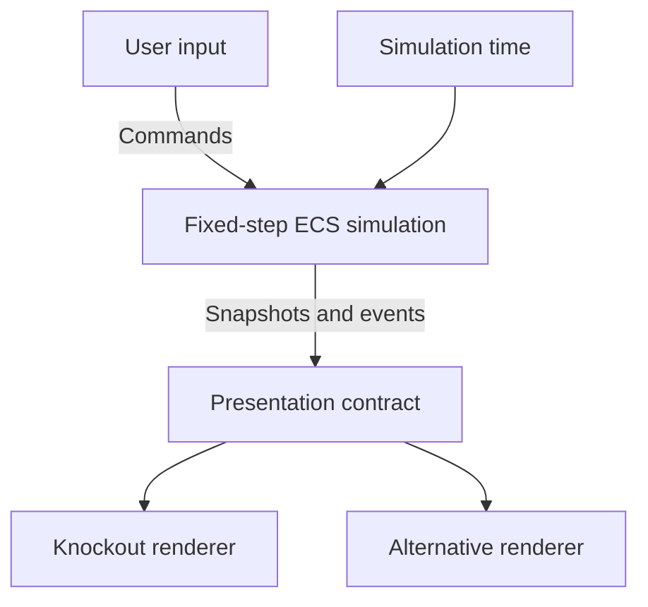

# Technical redesign: ECS simulation and replaceable presentation

Status: design proposal for the `CharlyMaye/pokeclicker` fork.
This document defines the target and the first migration stages. It does not describe an implementation that has already been completed.

## Goals and constraints

The simulation follows an Entity Component System (ECS) approach. Use OOP and SOLID where they support clear responsibilities and contracts. Keep the code readable, explicit and defensive, without imposing the layers of Clean Architecture.

Game logic includes combat, progression, the economy, captures, timers and offline rewards. It must run without a display. Simulation and presentation have independent loops, responsibilities and update rates. Replacing the interface must not change the rules.

Migration baseline: preserve existing gameplay, content and player progress. Identify any intentional balance or timing change separately. Existing saves require a versioned, tested import process that preserves the original for recovery.

## Language and review policy

Use English for code identifiers, comments, technical documentation, commit messages, PR titles and PR descriptions. Keep player-facing translations in the existing localization system.

Keep unfinished work in draft PRs. Before marking a PR ready for review, inspect its final diff and verify the relevant checks on its latest commit. Tell the user what changed, which checks passed, what needs their attention and which branch will receive the changes.

Prefer larger, coherent feature PRs that include their contracts, implementation, build integration, tests and documentation. Avoid requiring a separate merge for each internal layer. Keep unrelated migrations separate so the combined behavior remains reviewable.

The user reviews the proposal and decides whether to merge it. A passing CI run supports that decision but does not replace the review. After a material update to a PR, reassess readiness and identify what needs another review.

## Branch organization

The redesign integration branch is `refactor/ecs`, created from `develop` at commit `66f2cc0f992d1ae2c7e6f7e171885ff1166835bf`.

| Branch | Purpose | PR target |
| --- | --- | --- |
| `develop` | Source of the published game and the GitHub Pages deployment. | Receives the redesign when it is ready to ship. |
| `refactor/ecs` | Integrates redesign stages and validates their combined behavior. | `develop` when shipping the redesign. |
| `docs/ecs-refactor-plan` | Technical planning and CI setup for the integration branch. | `refactor/ecs` |
| `feat/ecs-<topic>`, `fix/ecs-<topic>`, `test/ecs-<topic>` | One focused task per branch, created from the current `refactor/ecs` branch. | `refactor/ecs` |

Develop each new stage on a work branch and integrate it through a PR into `refactor/ecs`. Apply review changes on that work branch. Before starting a stage that depends on an earlier one, integrate the dependency and branch from the updated integration branch.

CI covers PRs targeting `develop` and `refactor/ecs`, as well as pushes to either branch. GitHub Pages publishes `develop`: integrating a stage into `refactor/ecs` does not replace the live game.

## Findings in the current code

Inspected `develop` at commit `66f2cc0f992d1ae2c7e6f7e171885ff1166835bf`:

| Location | Observed coupling | Migration consequence |
| --- | --- | --- |
| [Game.start](../src/scripts/Game.ts) | `requestAnimationFrame` triggers `gameTick`; the worker sends messages, but computation stays on the main thread. | Extract time scheduling and move the simulation itself into a worker. |
| [Game.gameTick](../src/scripts/Game.ts) | Coordinates combat, farming, saving, the calendar and notifications through global objects. | Make system order and external effects explicit. |
| [Battle](../src/modules/battles/Battle.ts) | Mixes Knockout state, `App.game` access, `Date.now`, random draws and captures scheduled with `setTimeout`. | Introduce combat data, commands and simulation deadlines. |
| [App](../src/scripts/App.ts) | Passes the game model directly to `ko.applyBindings`. | Build a presentation model separate from the ECS world. |
| [Save](../src/scripts/Save.ts) | Serialization depends on `App.game` properties and reactive objects. | Define a save format independent of internal ECS storage. |
| [Gulp](../gulpfile.babel.js) | Copies assets and translations into `build`, then `docs`; it has no automatic `public` convention. | Explicitly add copying and validation for the new public files. |

The current nominal tick is 100 ms, automatic attacks run every 1,000 ms and the click cooldown is 50 ms. Offline money rewards are capped at 24 hours with a 0.5 multiplier. These values are compatibility baselines, not new balance decisions.

## ECS model

- An entity is an instance identifier. A Pokemon definition belongs to a catalog; it is not a combat instance.
- A component holds data, such as `Health`, `Attack`, `AttackCooldown`, `CaptureAttempt` or `Encounter`. It contains neither UI observables nor rendering methods.
- A system applies a rule to a selection of entities. Its execution order and the components it reads or writes are explicit.
- The ECS world is the source of truth for migrated features. Apply entity creation and removal at defined boundaries so they do not invalidate iteration.
- Shared data such as validated rules, simulation time and random generator state are world resources. A wallet or catalog does not need to be artificially split into thousands of entities.

The first proposed systems cover command processing, attacks, defeat and rewards, captures, and spawning the next opponent. Establish their exact order through compatibility scenarios before connecting them to the existing game.

Systems may be functions. Classes remain appropriate for objects with a lifecycle, such as a simulation host, renderer or storage implementation. Apply SOLID to their small, replaceable contracts; it does not require an interface for every class or a Pokemon inheritance hierarchy.

## Simulation and presentation separation

This diagram shows data flow. The engine does not depend on renderer implementations.

### Exchange contract

- Input: typed commands such as `ClickAttack` or `ChangeRoute`. Record their order and their position on the simulation timeline to replay a scenario.
- Output: state projections detached from mutable components, and typed events such as `EnemyDefeated` or `CaptureResolved`.
- Presentation handles translation, formatting, animation and mapping identifiers to visual assets. The engine emits neither HTML nor sprite paths.
- The UI submits an intention. It does not decide damage, prices, rewards or whether an action is valid.
- The presentation model may own the selected tab and animation state. It does not maintain another authoritative copy of game rules.

Session identifiers and sequences allow stale messages to be rejected and events to be handled once. Intermediate snapshots may be replaced by a newer snapshot; commands and events required for progression must not be lost through that optimization.

### Two loops

The browser target runs the simulation inside a **dedicated Web Worker**, with a direct host for tests without a browser. The engine exposes an explicit advance operation; timer selection belongs to the host. A worker that only posts a tick to the UI thread does not meet this target.

Simulation advances in configured fixed steps. Separate monotonic session time from the civil calendar used for daily events. Supply external time and the random generator explicitly. For identical engine and data versions, the same timestamped inputs, initial state and random state must produce the same outcome.

Step granularity must not silently change gameplay: a 100 ms tick cannot collapse two clicks spaced 50 ms apart. The first stage must preserve command timestamps and deadlines within a step, or demonstrate through tests that a smaller step preserves the expected behavior.

Presentation runs its own `requestAnimationFrame` loop and reads the latest available snapshot. It may interpolate animations but never advances the world. An animation ending does not validate a capture: simulation determines its result and deadline.

Bound the catch-up budget per wake-up. Handle remaining time debt explicitly instead of silently discarding it. Long absences follow the existing offline progression rules, which differ from active play; resuming must not credit the same period twice. A worker does not guarantee that the browser will keep running the game while the device sleeps.

Bound queues and snapshot publication rates, and test their saturation policies. `start`, `stop` and `dispose` must manage timers, workers, subscriptions and late messages. A rendering failure must not corrupt the simulation.

## Proposed organization

| Target directory | Responsibility |
| --- | --- |
| `src/simulation/` | World, components, systems grouped by feature, rules and projections; strict TypeScript without DOM or Knockout. |
| `src/contracts/` | Serializable commands, projections, events and errors shared by simulation and clients. |
| `src/client/` | Input handling, presentation model, display loop and renderer implementations. |
| `src/runtime/` | Assembly, worker/direct hosts, file loading, clocks and browser storage. |
| `public/config/` | Simulation, combat, progression and persistence settings. |
| `public/data/` | Pokemon, route, item and other content catalogs. |
| `public/presentation/` | Themes, visual tokens and mappings between identifiers and assets. |
| `schemas/` | Validation schemas for configuration, data and saves. |

These directories form a minimal target and should be introduced when they have their first use. The new engine will compile and run tests without the DOM library. CI will also check forbidden imports; removing `dom` from `tsconfig` is insufficient if dependencies reintroduce browser globals.

Access to historical global modules is restricted to migration bridges. The existing build configuration must explicitly exclude the new sources from the legacy global compilation to avoid compiling them twice.

## JSON configuration policy

**Rule: content, balance and product settings must not be buried in systems.**

Example allocation:

| Proposed file | Contents |
| --- | --- |
| `public/config/simulation.json` | Simulation step, catch-up budgets and snapshot publication rate. |
| `public/config/combat.json` | Attack rates, click limits, coefficients and capture settings. |
| `public/config/progression.json` | Progression curves and parameters, including offline reward rules. |
| `public/config/persistence.json` | Save frequency and retention settings. |
| `public/data/pokemon.json` | Stable identifiers, attributes and references to other catalogs. |
| `public/presentation/default-theme.json` | Configurable color, spacing and animation-duration tokens. |

Algorithms remain in TypeScript. Mathematical or structural constants, such as the additive identity, do not become settings. Units and protocol versions remain named constants where they define a contract. Translatable text stays in the existing localization system.

Configurable behaviors use known, validated identifiers mapped to explicit code. Do not put JavaScript in JSON, use `eval` or build a general-purpose rule language merely to externalize a formula.

Use one loading pipeline: read, validate structure, validate business rules and cross-references, produce typed read-only data, then start. The engine receives validated data; its systems do not call `fetch` or reread JSON every tick.

Schemas check required fields, unknown properties, types, ranges and sizes. Business validation checks duplicate identifiers, missing references, probabilities, positive durations and relationships between settings. Establish one explicit policy connecting schemas and TypeScript types to prevent divergent definitions.

Defaults belong in versioned files. A missing or invalid required file prevents startup with a precise diagnostic; a hidden code fallback must not conceal the problem. Perform deep validation at boundaries. Internal systems operate on validated data and preserve their invariants without revalidating the entire catalog every tick.

The Gulp build must copy `public/**` to the root of `build`, then `docs`. On Pages, `public/config/combat.json` will therefore be served at `/pokeclicker/config/combat.json`, without the `public` segment. Loading must use an explicit application base URL, not `/config/...`, which would address the domain root.

Version code and data together. A version manifest and versioned or content-hashed data paths should detect incompatible cached combinations. Load a consistent set before startup; runtime rule hot-reloading is outside the first stage. These files are public and contain no secrets.

## Defensive programming and saves

- Validate commands, worker messages, JSON files and saves before mutation. Reject invalid actions explicitly with typed, contextual errors.
- Preserve invariants: finite values, valid health, sufficient funds, and permitted quantities and durations. An invalid transition must not be partially applied.
- Bound file sizes, command queues and catch-up work. Test saturation and missing resources.
- Distinguish expected errors from internal defects. Do not swallow exceptions and continue with corrupt state; stop the affected processing safely and retain a diagnostic.
- Save a versioned format with stable identifiers, progression, deadlines and random state. Do not depend on entity order, internal array indexes or Knockout instances.
- Migrate into a validated copy before activation, retain the original and never overwrite it on import failure. New-engine saves use a separate storage namespace while returning to the old engine must remain possible.
- Name values and units precisely, such as `durationMs`, `probability` and `amount`. Business policy parameters come from JSON; consistency checks remain code.

## Migration stages and acceptance criteria

| Stage | Deliverable | Exit criterion |
| --- | --- | --- |
| 1. Contracts and behavioral baseline | Representative combat scenarios, test save fixtures, documented timing rules, initial configuration matching existing values, and schemas. | CI rejects invalid data; cross-references and publication under the Pages subpath are verified. |
| 2. Headless ECS combat | One representative route, automatic and click attacks, defeat, rewards, capture and the next opponent; controlled time and RNG. | Reproducible expected outcomes checked against stage 1 scenarios, including timing boundaries and indirect combat effects. |
| 3. Two presentations of one engine | A Knockout bridge and a minimal diagnostic DOM display consuming the same contracts. | Renderer replacement without engine changes; identical outcomes without rendering and at different display rates. |
| 4. Worker and game integration | Actual worker execution, command translation, save import/export and bridges to historical features. | No double ticks, duplicate rewards or processing after shutdown; covered cases include hidden tabs, resuming, saving and late messages. |
| 5. Feature expansion | Other battles, wallet/progression, farming, breeding and remaining features through coherent feature PRs. | One authority per piece of state, regression scenarios and removal of obsolete legacy code at each stage. |

During migration, each feature has a single state owner. If ECS combat emits a reward still applied by the historical wallet, the bridge records its identifier and applies it once. Corresponding historical systems must not continue mutating that combat. Inventory effects on statistics, quests, breeding and items before enabling the new route.

Activation is controlled by an explicit configuration option. Tests use synthetic saves or saves provided for this work. Business-rule tests do not require a browser; integration tests separately cover the protocol, storage and interface. Set performance and snapshot-size budgets using measurements of the existing game.

## Open decisions

- ECS library or small internal core: compare on the first scenario using typing, determinism, serialization, maintenance and runtime cost as criteria. Do not build a complete generic engine before measuring the need.
- Next renderer technology: it is not required to define the contracts; Knockout can support the transition.
- Step granularity and detailed catch-up policy: decide using click/capture constraints, existing offline behavior and measurements.

## References

- [ECS entities, components and systems — Unity](https://docs.unity3d.com/Packages/com.unity.entities@1.0/manual/concepts-intro.html), a conceptual reference rather than a choice of Unity dependency.
- [Game Loop — Robert Nystrom](https://gameprogrammingpatterns.com/game-loop.html), on separating game progression from rendering frequency.
- [requestAnimationFrame — MDN](https://developer.mozilla.org/en-US/docs/Web/API/Window/requestAnimationFrame), on refresh timing and suspension in background tabs.
- [JSON Schema: objects, required fields and additional properties](https://json-schema.org/understanding-json-schema/reference/object).

## Worker execution milestone

The [worker runtime](worker-combat.md) now executes the existing route ECS in a dedicated worker, with bounded acknowledged delivery, an asynchronous input/lifecycle proxy, a browser asset and compiled-bundle tests. This completes the execution boundary within stage 4, not that entire stage: production content resolution, indirect progression bridges, legacy-save migration, offline/visibility policy and live activation remain outstanding. [Combat checkpoints](combat-checkpoints.md) now preserve and restore the prototype state through the worker and a separate storage namespace; this does not complete production save integration.

## Playable prototype milestone

The [combat lab](combat-lab.md) now connects worker combat, replaceable renderers, controls and checkpoint storage in an isolated page. Its JSON configuration and explicit visibility policy make stage 4 behavior reviewable end to end. This remains test balance; production content, progression and legacy-save integration are still outstanding.

The [live progression milestone](live-progression.md) now carries accumulated rewards, capture inventory and route totals in each committed worker frame, displays them in both presentations and restores them before the first worker wake. This is prototype-owned progress; historical wallet/party and indirect effects still require explicit ownership and parity work.

The [portable checkpoint milestone](portable-checkpoints.md) adds file export, validated preview and confirmed import across ECS sessions, completing the prototype file-transfer path within stage 4. Legacy-save migration and historical feature ownership remain separate acceptance work.

The [weighted encounter milestone](weighted-encounters.md) adds explicit weighted scenario data and a pure route-pool resolver, with differential legacy selection checks and worker checkpoint replay. Production catalog/stat resolution and dynamic requirement updates remain outstanding; existing lab configuration and saves retain uniform selection.

The [route content compiler](route-content.md) now combines explicit catalog snapshots, weighted pools and JSON-configured legacy health formulas into worker-ready scenarios. Health parity is tested against the real factory; production catalog extraction, normalized route resolution and non-health stat calculations still need adapters and compatibility tests.
