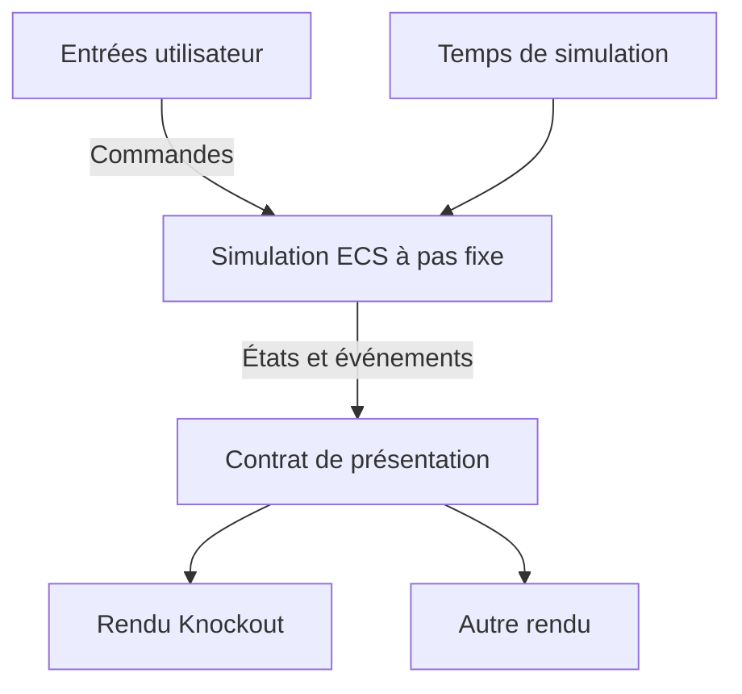

# Refonte technique : simulation ECS et présentation substituable

Statut : proposition de conception pour le fork `CharlyMaye/pokeclicker`.
Ce document définit la cible et les premiers lots ; il ne décrit pas une migration déjà réalisée.

## Objectif et contraintes

La simulation utilise une approche Entity Component System (ECS). L'OOP et SOLID servent les responsabilités et les contrats qui le justifient. Le code doit rester lisible, explicite et défensif, sans imposer le découpage en couches de la Clean Architecture.

L'intelligence du jeu comprend toutes ses règles : combat, progression, économie, captures, temporisations et gains hors ligne. Elle doit fonctionner sans affichage. La boucle de simulation et la boucle de présentation ont des responsabilités et des cadences indépendantes. Remplacer une interface ne doit pas modifier les règles.

Hypothèse de migration : conserver le gameplay, les contenus et la progression existants. Toute différence intentionnelle d'équilibrage ou de comportement temporel doit être identifiée séparément. Les sauvegardes existantes nécessitent un import versionné, testé et réversible par conservation de l'original.

## Constats sur le code actuel

Inspection de `develop` au commit `66f2cc0f992d1ae2c7e6f7e171885ff1166835bf` :

| Emplacement | Couplage observé | Conséquence pour la migration |
| --- | --- | --- |
| [Game.start](../src/scripts/Game.ts) | `requestAnimationFrame` déclenche `gameTick` ; le worker envoie des messages, mais le calcul reste dans le thread principal. | Extraire le pilotage temporel et déplacer réellement la simulation dans un worker. |
| [Game.gameTick](../src/scripts/Game.ts) | Orchestre combat, ferme, sauvegarde, calendrier et notifications via des objets globaux. | Rendre explicites l'ordre des systèmes et les effets externes. |
| [Battle](../src/modules/battles/Battle.ts) | État Knockout, accès à `App.game`, `Date.now`, tirages aléatoires et capture via `setTimeout`. | Introduire des données de combat, des commandes et des échéances de simulation. |
| [App](../src/scripts/App.ts) | Le modèle de jeu est directement fourni à `ko.applyBindings`. | Construire un modèle de présentation distinct du monde ECS. |
| [Save](../src/scripts/Save.ts) | Sérialisation liée aux propriétés de `App.game` et aux objets réactifs. | Définir un format de sauvegarde indépendant du stockage interne de l'ECS. |
| [Gulp](../gulpfile.babel.js) | Copie des assets et traductions vers `build`, puis vers `docs` ; aucune convention automatique pour `public`. | Ajouter explicitement la copie et la validation des futurs fichiers publics. |

Le tick nominal actuel vaut 100 ms, l'attaque automatique 1 000 ms et la limite des clics 50 ms. Le bonus d'argent hors ligne est plafonné à 24 heures avec un multiplicateur de 0,5. Ces valeurs sont des références de compatibilité, pas de nouvelles décisions d'équilibrage.

## Modèle ECS

- Une entité est un identifiant d'instance. Une définition de Pokémon appartient au catalogue ; ce n'est pas une instance de combat.
- Un composant contient des données : `Health`, `Attack`, `AttackCooldown`, `CaptureAttempt`, `Encounter`, par exemple. Il ne contient ni observable UI, ni méthode de rendu.
- Un système applique une règle à une sélection d'entités. Son ordre et les composants qu'il lit ou modifie sont explicites.
- Le monde ECS est la source de vérité des fonctionnalités migrées. Les créations et suppressions d'entités sont appliquées à des points définis pour ne pas invalider une itération.
- Les données globales telles que les règles validées, le temps de simulation et l'état du générateur aléatoire sont des ressources du monde. Un portefeuille ou un catalogue n'a pas besoin d'être artificiellement transformé en milliers d'entités.

Premier ensemble de systèmes envisagé : consommation des commandes, attaques, défaite et récompenses, capture, génération du prochain adversaire. L'ordre exact doit être fixé par les scénarios de compatibilité avant le branchement à l'ancien jeu.

Les systèmes peuvent être des fonctions. Des classes restent adaptées à un objet qui possède un cycle de vie, comme un hôte de simulation, un rendu ou un stockage. SOLID s'applique notamment à leurs petits contrats remplaçables ; il n'impose ni une interface pour chaque classe ni une hiérarchie d'héritage des Pokémon.

## Séparation simulation / présentation

Ce schéma représente les flux de données. Le moteur ne dépend pas des implémentations de rendu.

### Contrat d'échange

- Entrée : commandes typées telles que `ClickAttack` ou `ChangeRoute`. Leur ordre et leur instant dans la chronologie de simulation sont enregistrables pour rejouer un scénario.
- Sortie : projections de l'état, détachées des composants mutables, et événements typés tels que `EnemyDefeated` ou `CaptureResolved`.
- La présentation traduit, formate, anime et associe les identifiants aux ressources visuelles. Le moteur n'émet ni HTML ni chemins de sprites.
- L'UI transmet une intention ; elle ne décide pas d'un dégât, d'un prix, d'une récompense ou de la validité d'une action.
- Le modèle de présentation peut conserver la sélection d'un onglet et les animations. Il ne maintient pas une seconde copie autoritaire des règles du jeu.

Des identifiants de session et des séquences permettent de rejeter un message obsolète et de ne pas rejouer deux fois un événement. Les états intermédiaires peuvent être remplacés par un état plus récent ; les commandes et événements nécessaires à la progression ne doivent pas être perdus par cette optimisation.

### Deux boucles

La cible navigateur est une simulation dans un **Web Worker dédié**, avec un hôte direct pour les tests sans navigateur. Le moteur expose une opération d'avancement explicite ; le choix du timer appartient à l'hôte. Un worker qui se contente de poster « tick » au thread UI ne satisfait pas cette cible.

La simulation progresse par pas fixes configurés. Le temps monotone de session est séparé du calendrier civil utilisé pour les événements quotidiens. L'heure externe et le générateur aléatoire sont fournis explicitement. À versions de moteur et de données identiques, les mêmes entrées horodatées, le même état initial et le même état aléatoire doivent produire le même résultat.

La granularité ne doit pas changer silencieusement le jeu : un tick de 100 ms ne permet pas de fusionner deux clics espacés de 50 ms. Le premier lot doit conserver les instants des commandes et les échéances à l'intérieur du pas, ou démontrer par tests qu'un pas plus fin conserve les comportements attendus.

La présentation utilise sa propre boucle `requestAnimationFrame` et lit le dernier état disponible. Elle peut interpoler une animation, mais ne fait jamais avancer le monde. La fin d'une animation ne valide pas une capture : le résultat et l'échéance sont décidés par la simulation.

Le budget de rattrapage par réveil est borné. Le retard restant doit avoir un traitement explicite, pas être silencieusement supprimé. Les longues absences suivent les règles de progression hors ligne existantes, distinctes de l'activité en direct ; aucun double crédit ne doit être possible au retour. Un worker ne garantit pas que le navigateur continue à exécuter le jeu pendant une mise en veille.

Les files et la cadence des projections sont bornées ; leur politique de saturation est testée. `start`, `stop` et `dispose` doivent gérer timers, worker, abonnements et messages tardifs. Une erreur du rendu ne doit pas corrompre la simulation.

## Organisation proposée

| Répertoire cible | Responsabilité |
| --- | --- |
| `src/simulation/` | Monde, composants, systèmes regroupés par fonctionnalité, règles et projections ; TypeScript strict, sans DOM ni Knockout. |
| `src/contracts/` | Commandes, projections, événements et erreurs sérialisables partagés entre simulation et clients. |
| `src/client/` | Entrées, modèle de présentation, boucle d'affichage, implémentations de rendu. |
| `src/runtime/` | Assemblage, hôte worker/direct, chargement des fichiers, horloges et stockage navigateur. |
| `public/config/` | Paramètres de simulation, de combat, de progression et de persistance. |
| `public/data/` | Catalogues de Pokémon, routes, objets et autres définitions de contenu. |
| `public/presentation/` | Thèmes, tokens visuels et associations entre identifiants et assets. |
| `schemas/` | Schémas de validation des configurations, données et sauvegardes. |

Ces répertoires constituent une cible minimale, à introduire quand un premier usage existe. Le nouveau moteur aura une compilation et des tests sans bibliothèque DOM. La CI contrôlera également les imports interdits ; supprimer `dom` du `tsconfig` ne suffit pas si des dépendances réintroduisent des globals.

Les répertoires globaux historiques restent accessibles uniquement depuis les raccordements de migration. La configuration du build actuel doit exclure explicitement les nouvelles sources de la compilation globale historique pour éviter une double compilation.

## Politique de configuration JSON

**Règle : aucune valeur de contenu, d'équilibrage ou de réglage produit ne doit être enfouie dans les systèmes.**

Exemples de répartition :

| Fichier envisagé | Contenu |
| --- | --- |
| `public/config/simulation.json` | Pas de simulation, budgets de rattrapage et cadence des projections. |
| `public/config/combat.json` | Cadences, limites de clic, coefficients et paramètres de capture. |
| `public/config/progression.json` | Courbes et paramètres de progression, règles des gains hors ligne. |
| `public/config/persistence.json` | Fréquence de sauvegarde et paramètres de conservation. |
| `public/data/pokemon.json` | Identifiants stables, caractéristiques et références aux autres catalogues. |
| `public/presentation/default-theme.json` | Tokens de couleurs, espacements et durées d'animations configurables. |

Les algorithmes restent en TypeScript. Les constantes mathématiques ou structurelles, comme l'élément neutre d'une addition, ne deviennent pas des paramètres. Les unités et versions de protocole restent des constantes nommées lorsqu'elles définissent un contrat. Les textes traduisibles restent dans le système de localisation existant.

Les comportements configurables utilisent des identifiants connus et validés, associés à du code explicite. Pas de JavaScript dans les JSON, de `eval` ou de langage de règles généraliste construit pour externaliser une formule.

Le chargement suit une seule chaîne : lecture → validation structurelle → validation métier et références croisées → données typées en lecture seule → démarrage. Le moteur reçoit les données déjà validées ; ses systèmes n'effectuent pas de `fetch` et ne relisent pas de JSON à chaque tick.

Les schémas contrôlent les champs requis, propriétés inconnues, types, bornes et tailles. La validation métier contrôle notamment les identifiants dupliqués, références inexistantes, probabilités, durées positives et relations entre paramètres. Une politique explicite relie schéma et types TypeScript pour éviter deux définitions divergentes.

Les valeurs par défaut sont dans les fichiers versionnés. Un fichier obligatoire absent ou invalide empêche le démarrage avec un diagnostic précis ; une valeur cachée dans le code ne doit pas masquer le problème. La validation approfondie se fait aux frontières ; les systèmes internes travaillent sur les données validées et maintiennent leurs invariants sans revalider tout le catalogue à chaque tick.

Le build Gulp devra copier `public/**` à la racine de `build`, puis de `docs`. Sur Pages, `public/config/combat.json` sera donc servi sous `/pokeclicker/config/combat.json`, sans le segment `public`. Le chargement utilisera une base d'application explicite, pas un chemin `/config/...` qui pointerait à la racine du domaine.

Code et données doivent être versionnés ensemble. Un manifeste de version et des chemins de données versionnés ou empreintés permettront de détecter les mélanges dus au cache. Le chargement charge un ensemble cohérent avant de démarrer ; aucun rechargement à chaud des règles n'est prévu pour le premier lot. Ces fichiers sont publics et ne contiennent aucun secret.

## Programmation défensive et sauvegardes

- Valider commandes, messages worker, fichiers JSON et sauvegardes avant toute mutation. Rejeter explicitement une action invalide avec une erreur typée et contextualisée.
- Préserver les invariants : valeurs finies, santé valide, fonds suffisants, quantités et durées autorisées. Une transition invalide ne doit pas être partiellement appliquée.
- Borner tailles de fichiers, files de commandes et travail de rattrapage. Tester saturation et absence de ressources.
- Distinguer erreurs attendues et défauts internes. Ne pas avaler une exception pour poursuivre avec un état corrompu ; interrompre proprement le traitement concerné et conserver un diagnostic.
- Sauvegarder un format versionné avec identifiants stables, progression, échéances et état aléatoire. Ne pas dépendre de l'ordre des entités, des index de tableaux internes ou d'une instance Knockout.
- Migrer dans une copie validée avant activation, conserver l'original et ne pas l'écraser si l'import échoue. Une sauvegarde issue du nouveau moteur utilise un espace distinct tant que le retour à l'ancien moteur est nécessaire.
- Nommer précisément nombres et unités (`durationMs`, `probability`, `amount`). Les paramètres de politique métier viennent des JSON ; les validations de cohérence restent du code.

## Migration par lots vérifiables

| Lot | Livrable | Critère de sortie |
| --- | --- | --- |
| 1. Contrats et référence de comportement | Scénarios de combat représentatifs, fixtures de sauvegardes de test, règles temporelles documentées, configuration initiale avec valeurs existantes et schémas. | Données invalides rejetées en CI ; références croisées et publication sous le sous-chemin Pages vérifiées. |
| 2. Combat ECS sans affichage | Une route représentative, attaque automatique et clic, défaite, récompense, capture et adversaire suivant ; temps et RNG contrôlés. | Résultats attendus reproductibles, contrôlés avec les scénarios du lot 1, y compris seuils temporels et effets indirects du combat. |
| 3. Deux présentations du même moteur | Adaptation Knockout et affichage DOM minimal de diagnostic consommant les mêmes contrats. | Changement de rendu sans modification du moteur ; résultats identiques sans rendu et avec des cadences d'affichage différentes. |
| 4. Worker et raccordement au jeu | Exécution réelle dans le worker, traduction des commandes, import/export et raccordements aux fonctionnalités historiques. | Aucun double tick, double gain ou traitement après arrêt ; cas onglet masqué, reprise, sauvegarde et messages tardifs couverts. |
| 5. Extension fonctionnelle | Autres combats, portefeuille/progression, ferme, élevage et fonctionnalités restantes, par petites PR. | Une autorité par donnée, scénarios de non-régression et retrait du code historique devenu inutile à chaque lot. |

Pendant la transition, une fonctionnalité a un seul propriétaire de l'état. Si le combat ECS émet une récompense encore appliquée par le portefeuille historique, le raccordement enregistre son identifiant et l'applique une fois. Les systèmes historiques correspondants ne doivent pas continuer à modifier ce même combat. Les effets sur statistiques, quêtes, élevage et objets doivent être inventoriés avant d'activer la nouvelle route.

L'activation sera contrôlée par une option de configuration explicite. Les tests utiliseront des sauvegardes synthétiques ou fournies pour ce travail. Les tests métier ne dépendent pas d'un navigateur ; les tests d'intégration vérifient séparément le protocole, le stockage et l'interface. Les budgets de performance et de taille des projections seront fixés à partir de mesures du jeu actuel.

## Choix encore ouverts

- Bibliothèque ECS ou petit noyau interne : comparer sur le premier scénario, avec critères de typage, déterminisme, sérialisation, maintenance et coût. Ne pas développer un moteur générique complet avant cette mesure.
- Technologie du prochain rendu : elle n'est pas nécessaire pour définir les contrats ; Knockout peut servir à la transition.
- Granularité du pas et politique détaillée de rattrapage : décider à partir des contraintes de clic/capture, du comportement hors ligne existant et des mesures.

## Références

- [ECS : entités, composants et systèmes — Unity](https://docs.unity3d.com/Packages/com.unity.entities@1.0/manual/concepts-intro.html), référence conceptuelle, sans choix de dépendance Unity.
- [Game Loop — Robert Nystrom](https://gameprogrammingpatterns.com/game-loop.html), pour séparer l'avancement du jeu du rythme du rendu.
- [requestAnimationFrame — MDN](https://developer.mozilla.org/en-US/docs/Web/API/Window/requestAnimationFrame), pour son lien avec le rafraîchissement et sa suspension en arrière-plan.
- [JSON Schema : objets, champs requis et propriétés supplémentaires](https://json-schema.org/understanding-json-schema/reference/object).
